<p align="center">
  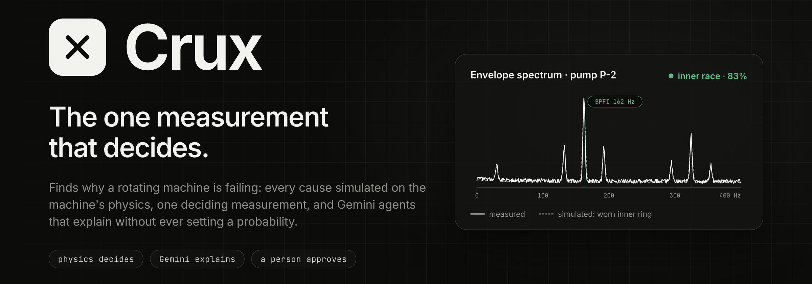
</p>

<p align="center">
  <a href="https://github.com/Umang3172/crux/actions/workflows/ci.yml"></a>
  <a href="https://hypothesis-engine-errupcwbra-el.a.run.app"></a>
  <a href="https://www.youtube.com/watch?v=PJ6h7AE1nxY"></a>
  <a href="https://crux-docs-errupcwbra-el.a.run.app"></a>
  <a href="LICENSE"></a>
  
</p>

<p align="center">
  
  
  
  
  
  
  
  
</p>

<p align="center">
  <b><a href="https://hypothesis-engine-errupcwbra-el.a.run.app">Live demo</a></b> ·
  <b><a href="https://www.youtube.com/watch?v=PJ6h7AE1nxY">Demo video</a></b> ·
  <a href="https://crux-docs-errupcwbra-el.a.run.app">Documentation &amp; team</a> ·
  <a href="#quick-start">Quick start</a> ·
  <a href="docs/ARCHITECTURE.md">Architecture</a> ·
  <a href="docs/DOMAIN.md">The physics</a> ·
  <a href="docs/DECISIONS.md">Design decisions</a>
</p>

<p align="center"><sub>Team <b>MechNova</b> · Google Cloud AI Builder Cup 2026 · Theme 3: Manufacturing</sub></p>

---

**Crux finds out _why_ a rotating machine is failing, and proves it before anyone opens it up.**

Most machine-health tools say a machine is abnormal. Crux works out the cause. It holds every
competing physical explanation, simulates the vibration each one would produce on *this* machine
at *this* speed, and scores the real capture against all of them. When the capture can't decide,
it asks a person for the **single measurement worth the most per minute of their time**, and shows
what each suspect expects it to read. Below 80% belief, or while the signal holds something no
suspect explains, it names no cause: it says *"can't tell"*, and why.

Two **Gemini** agents run the investigation through tools, read the machine's manual, propose
causes nobody listed, and write the report. None of their tools accepts a probability, so **the
physics decides, Gemini explains, and a person approves.**

> It is not a classifier. There is no path from features to a label.

<p align="center">
  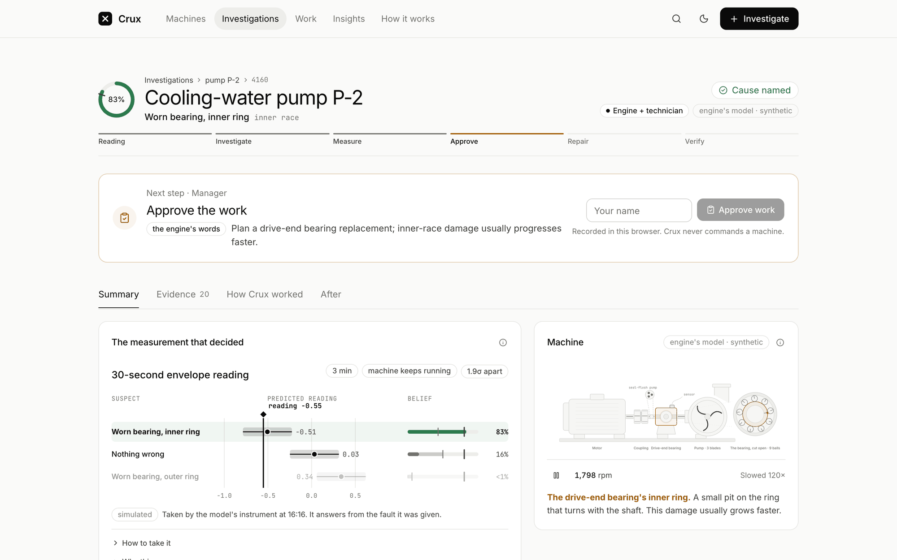
  <br><sub>One measurement decided it: the reading (−0.55) landed on the worn inner ring's prediction (−0.51), and belief rose from 43% to 83%.</sub>
</p>

<p align="center">▶ <b><a href="https://www.youtube.com/watch?v=PJ6h7AE1nxY">Watch the demo video</a></b> · or <a href="https://hypothesis-engine-errupcwbra-el.a.run.app/#/go/tour">take the guided tour on the live app</a></p>

## Contents

- [Highlights](#highlights)
- [How it works](#how-it-works)
- [The physics engine](#the-physics-engine)
- [The Gemini agents](#the-gemini-agents)
- [A tour of the app](#a-tour-of-the-app)
- [Results](#results)
- [Architecture on Google Cloud](#architecture-on-google-cloud)
- [Tech stack](#tech-stack)
- [Quick start](#quick-start)
- [Configuration](#configuration)
- [Command line](#command-line)
- [HTTP API](#http-api)
- [Deploying to Cloud Run](#deploying-to-cloud-run)
- [Project layout](#project-layout)
- [Design principles](#design-principles)
- [Datasets](#datasets)
- [Contributing](#contributing)
- [Team](#team)
- [Licence](#licence)

## Highlights

- **Virtual experiments, not a classifier.** Every suspect cause is simulated on the machine's own
  bearing geometry and speed (104 simulated captures per case) and scored line by line against the
  real capture.
- **The one measurement that decides.** When two causes still fit, Crux picks the check with the
  most expected information per technician-minute, and shows what each suspect predicts it will read.
- **"Can't tell" is an answer.** No verdict below 80% belief, or while the capture holds a periodic
  impact no suspect explains. On 180 hard test cases it named 130 causes and got **none wrong**.
- **Gemini that can't move a belief.** An investigator and a critic act through 13 tools. The critic
  can read the machine's manual and write a new suspect, but only the physics can score it.
- **Every sentence checked.** Each sentence Gemini writes in a report is kept only if every number and
  named cause in it is in the evidence it cites. The ones that fail are struck out, with the reason.
- **A whole plant, end to end.** A control room for every machine, a technician's to-do list,
  sign-offs, work orders, a repair check that confirms the fault is gone, and lessons shared between sites.
- **Phone video as a sensor.** Lens reads how a machine shakes from a ten-second phone clip, through
  the same physics. A scan can even answer the check a case asks for: the microphone the envelope check,
  the camera the shaft-line checks, each reading carrying an uncertainty worked out from the clip, so a
  phone moves the beliefs less than a sensor would.
- **Forecasts on Google's models.** TimesFM 3.0, ARIMA_PLUS and contribution analysis run inside
  BigQuery on a real metro-train compressor's history.
- **Runs with no keys.** Without credentials an offline stand-in drives the same tools, every number is
  the same, and the screen says so. CI has no secrets.

## How it works

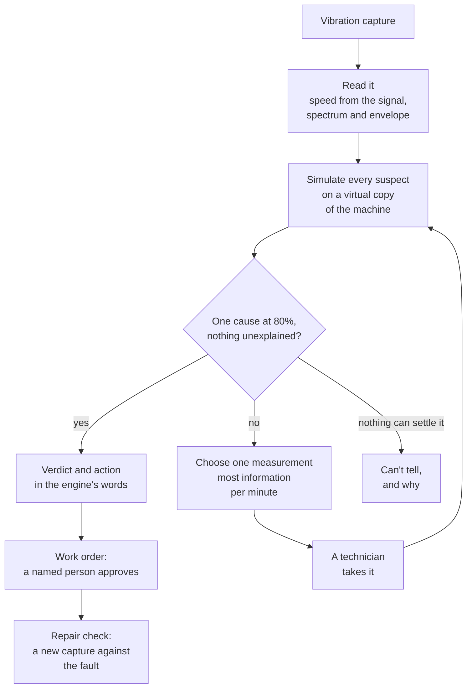

1. **Watch.** A machine's capture arrives: from the demo plant's physics model, a recorded run, an
   ESP32 sensor posting to `/ingest`, or a phone video.
2. **Read.** Speed is measured from the signal itself (order tracking), then the spectrum and the
   envelope spectrum, where bearing impacts show, are read as named physical lines.
3. **Experiment.** Each suspect (healthy, imbalance, misalignment, looseness, outer-race and
   inner-race bearing damage, plus any the critic writes) is synthesised at five severities and
   four seeds, at the capture's own speed and noise, and scored against the real capture.
4. **Decide or ask.** If one cause passes 80% and nothing is left unexplained, Crux names it. If
   not, it asks for the measurement that best separates the leaders, per minute of a person's time.
5. **Hand over.** The verdict becomes a work order. A named person approves it; Crux never touches
   machine control. After the repair, a new capture checks the fault is really gone.

## The physics engine

Everything that moves a belief is deterministic, inspectable and documented in
[`docs/DOMAIN.md`](docs/DOMAIN.md), with a source for every constant.

**Fault frequencies from geometry.** Bearing defect frequencies come from the textbook kinematic
formulas (`physics/frequencies.py`). For the SKF 6205-2RS bearing (9 balls, 7.94 mm ball,
39.04 mm pitch) they are, as multiples of shaft speed:

| Line | Formula | × shaft speed | What it means |
|---|---|---|---|
| FTF | ½ (1 − d/D cos α) | 0.3983 | the cage turning |
| BPFO | n/2 (1 − d/D cos α) | 3.5848 | a ball rolling over a pit in the outer ring |
| BPFI | n/2 (1 + d/D cos α) | 5.4152 | a ball rolling over a pit in the inner ring |
| BSF | D/2d (1 − (d/D cos α)²) | 2.3567 | a ball spinning (damage shows at 2 × BSF) |

These match the values published for the CWRU test rig, and `tests/test_frequencies.py` checks them.

**What each fault looks like** (`physics/signatures.py`). Imbalance is a dominant 1×.
Misalignment puts 2× above 1×. Looseness is a long run of harmonics with half-orders. Outer-race
damage is a train of impacts at BPFO, each ringing a structural resonance. Inner-race damage is the
same at BPFI, amplitude-modulated once per turn, which puts sidebands at BPFI ± 1×.

**Virtual experiments** (`physics/synth.py`, `physics/likelihood.py`). Each suspect is rendered as a
waveform (tones, impact trains with 1% slip jitter, resonance ringing and noise) and measured by the
same code that reads the real capture. Every predicted line is read as its height over the local
noise floor, so a line a suspect predicts and the capture lacks counts *against* that suspect. Each
line is scored with a Student-t (4 degrees of freedom, so no single line decides a case), widened by
a stated model-mismatch allowance, and averaged over the unknown severity. This is the
synthetic-likelihood idea (Wood, *Nature* 2010), used to choose between physical models.

**One writer of beliefs** (`investigation/engine.py`). The posterior is prior × likelihood of all the
evidence so far, normalised, written in one function. A verdict needs 80%. A periodic impact no
suspect explains blocks a verdict, using a false-alarm threshold set at 1% per capture. So does a
reading more than 4σ from every prediction, or a vibration level that has doubled over the machine's
own normal while "healthy" leads.

**Choosing the next measurement.** For each test on the menu (a 10 s capture, a 30 s envelope
capture, a half-order check, housing temperature, a coast-down), every live suspect is simulated
answering it. The expected drop in uncertainty, divided by the technician-minutes it takes, ranks
them. A test is offered only if some answer could settle the case and the two leaders are expected
to read at least 1σ apart. The menu, and why each test won or lost, is shown on the case.

**The machine's own normal** (`physics/normal.py`). Given healthy captures of the same machine, a
case is scored on its change from them, rather than against a textbook machine.

## The Gemini agents

Two agents run a case in a loop built on Google's **Agent Development Kit**
(`agents/investigator.py`), on **Gemini 3.8 Flash via Vertex AI**. The tools are split so the agent
that can close a case can't write a suspect, and the other way round:

| Tool | Investigator | Critic | What it does |
|---|:---:|:---:|---|
| `get_case` | ✓ | ✓ | the suspects and their beliefs, the evidence, requests and narration |
| `recall_cases` | ✓ | ✓ | how earlier cases on this machine ended |
| `extract_features` | ✓ | | the named observations and the bearing's frequencies |
| `run_virtual_experiments` | ✓ | | simulate every suspect on this machine and score the capture |
| `choose_next_test` | ✓ | | ask the physics which single measurement separates the leaders |
| `request_measurement` | ✓ | | send that measurement to the technician |
| `measurement_status` | ✓ | | whether it has been answered |
| `bearing_frequency_matches` | | ✓ | which bearing frequency an unexplained impact sits on |
| `search_knowledge` | | ✓ | look in the machine's manual and notes |
| `propose_suspect` | | ✓ | write a cause the catalogue lacks, as the vibration it would make |
| `narrate` | ✓ | ✓ | a plain-language line for the people watching (not evidence) |
| `conclude` | ✓ | | ask to close on the leader: refused below 80% or with anything unexplained |
| `declare_unresolved` | ✓ | | close without a cause: the honest answer |

- **No tool takes a probability, a score or a reading**, so nothing a model writes can set a belief.
- **Plain code ends the loop:** 6 rounds, 30 model calls or 120 seconds, whichever comes first.
- **A suspect the critic writes from a document** must cite a passage that exists and states its
  numbers. The physics then simulates it and scores it on all the evidence, like any other.
- **Without credentials,** an offline stand-in runs the same tools, and the screen says which is running.

Gemini also writes the case report (each sentence checked against the evidence it cites), drafts work
orders, turns a closed case into a lesson, summarises Trends, and looks at camera stills and phone
videos. What a vision model sees is labelled unconfirmed and never reaches an investigation.

<p align="center">
  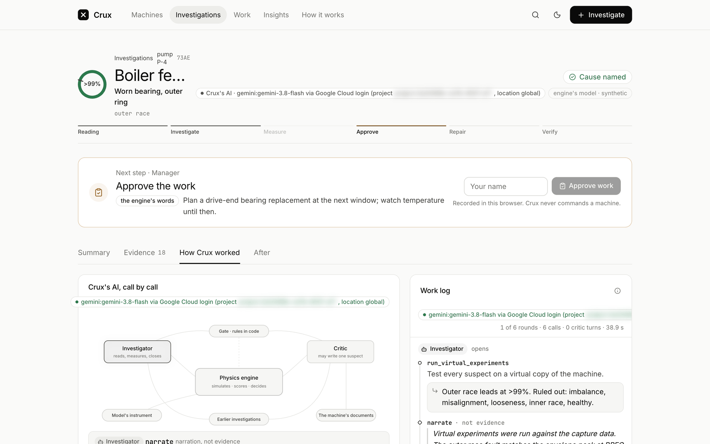
  <br><sub>A live run on Cloud Run: each tool call Gemini makes, and what the physics answered.</sub>
</p>

## A tour of the app

Five sections across the top, each with its pages as tabs. The demo plant's machines send readings
from a physics model with a hidden fault, and every page says when a number is synthetic.

| Section | Pages | What you can do |
|---|---|---|
| **Machines** | Overview · Control room | See every machine and whose turn it is; open a machine; start a shift. The air compressor's page opens its recorded history in Trends |
| **Investigations** | Investigations | Follow a case from reading to verdict: the deciding measurement, the evidence ledger, the AI's work, the report and the repair check |
| **Work** | To do · Sign-offs · Work orders · Phone scans | The technician's list, a manager's approvals, work orders with their evidence, and Lens, whose scan can answer a case's check |
| **Insights** | Trends · Track record · Lessons | Google's forecasts on a compressor's history, every method's results beside its baselines, and lessons between sites |
| **How it works** | Overview · The AI at work · Anatomy · System | The loop in plain words, the agents and their rules, the machines drawn from the engine's numbers, and system status |

<table>
  <tr>
    <td width="50%">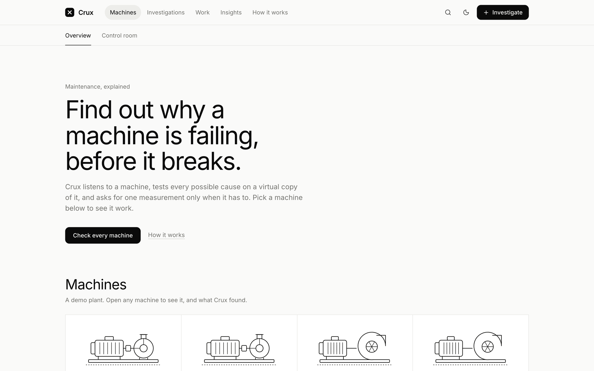<br><b>Home.</b> Every machine on the demo plant, one click from an investigation.</td>
    <td width="50%">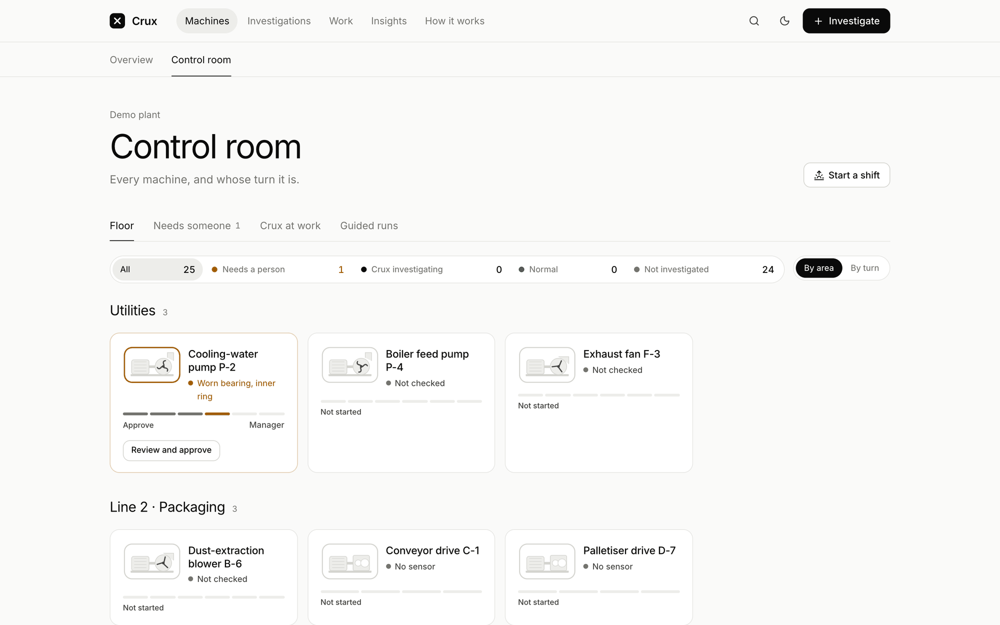<br><b>Control room.</b> A shift across the plant: reading, investigate, measure, approve, repair, verify.</td>
  </tr>
  <tr>
    <td>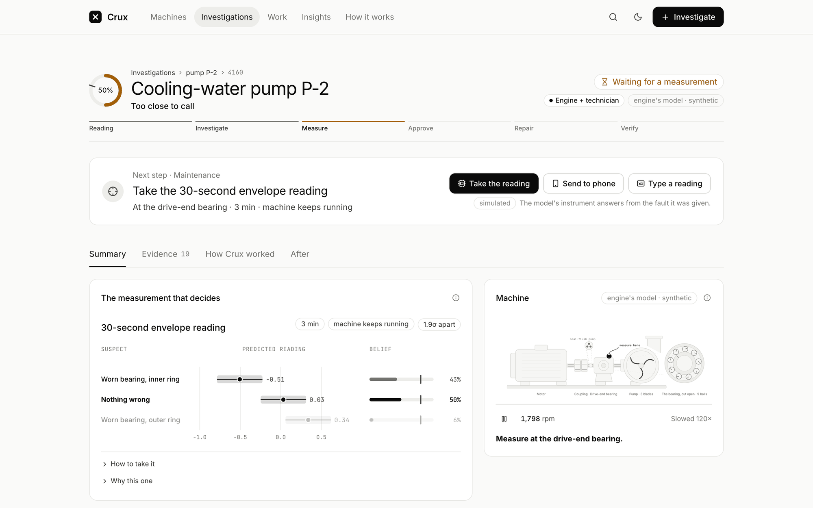<br><b>Too close to call.</b> Two causes still fit, so Crux asks for one 3-minute check, with the machine still running.</td>
    <td>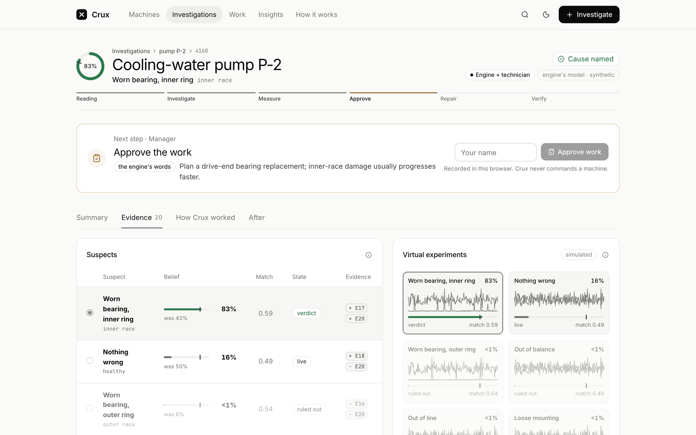<br><b>Evidence.</b> Every suspect's fit, and its simulated spectrum against the measured one.</td>
  </tr>
  <tr>
    <td>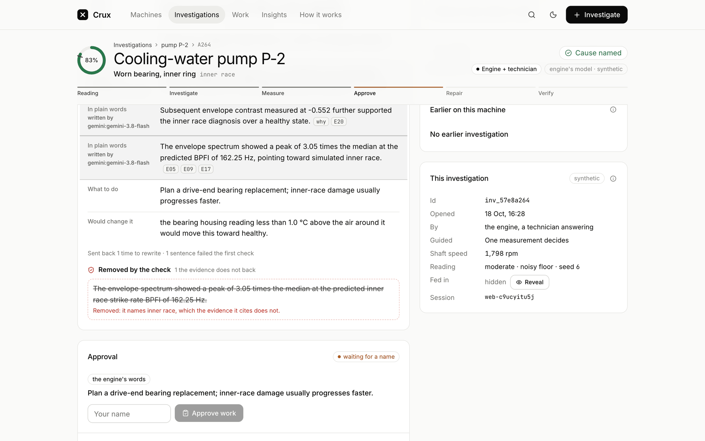<br><b>The check at work.</b> A sentence Gemini wrote that the evidence doesn't back is struck out, with the reason.</td>
    <td>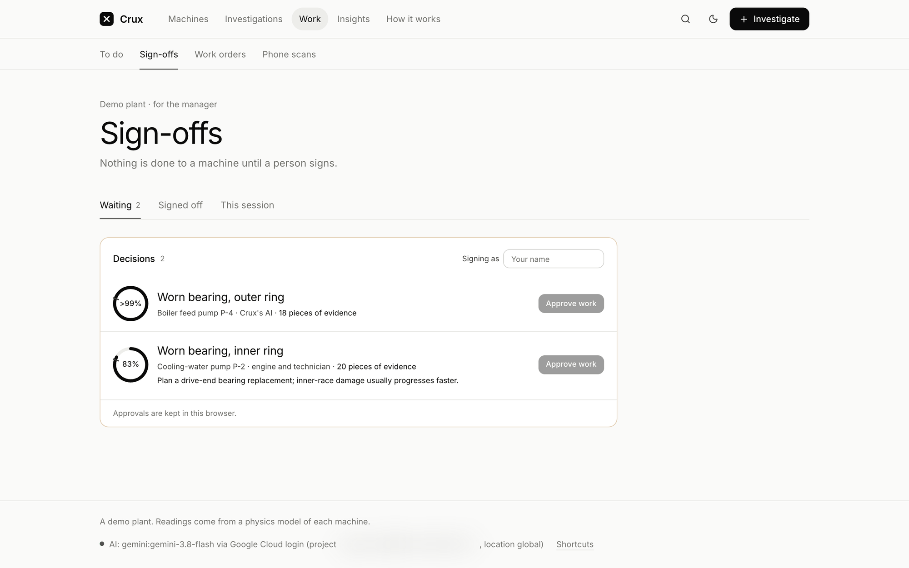<br><b>Sign-offs.</b> A named person approves the work; Crux never commands a machine.</td>
  </tr>
  <tr>
    <td>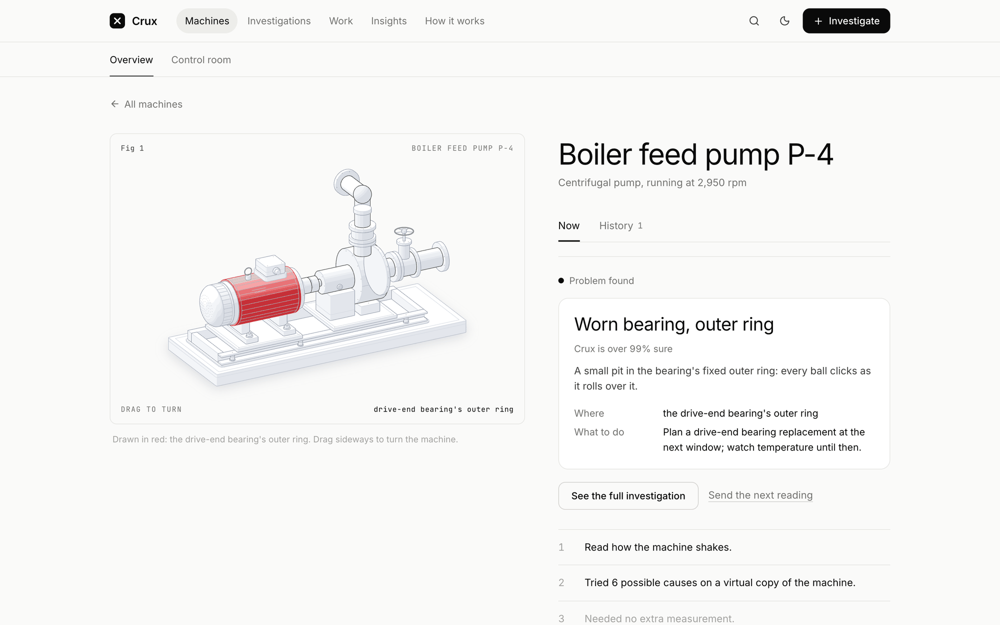<br><b>A machine's page.</b> Gemini ran the case; the physics named the worn outer ring at over 99% and the drawing shows where.</td>
    <td>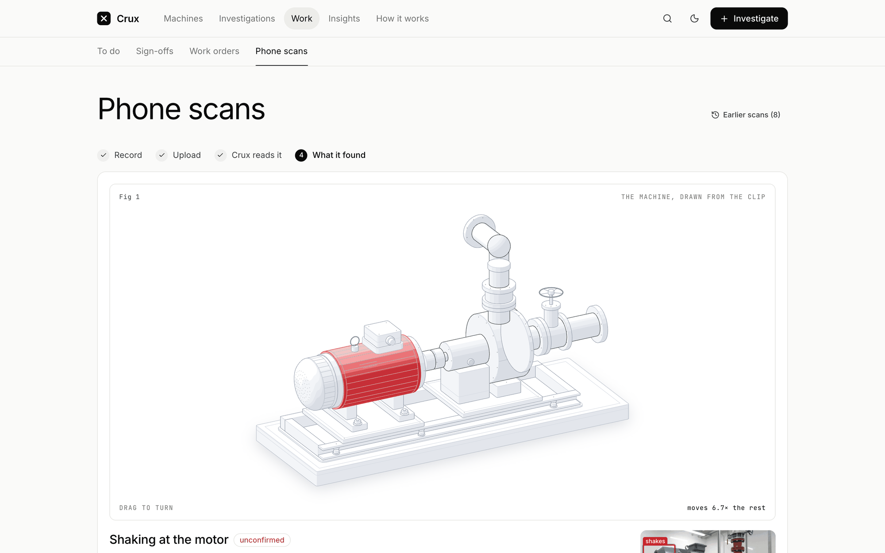<br><b>Phone scans (Lens).</b> A ten-second clip read as motion through the physics: here, shaking at the motor. What the camera sees stays unconfirmed.</td>
  </tr>
  <tr>
    <td>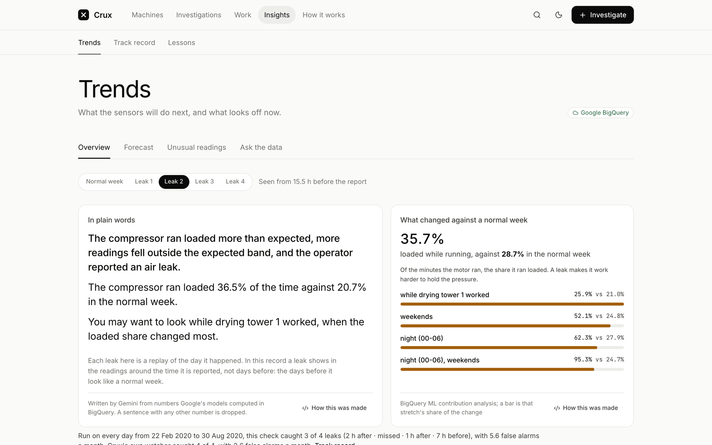<br><b>Trends.</b> What changed against a normal week, from BigQuery ML contribution analysis, summed up by Gemini.</td>
    <td>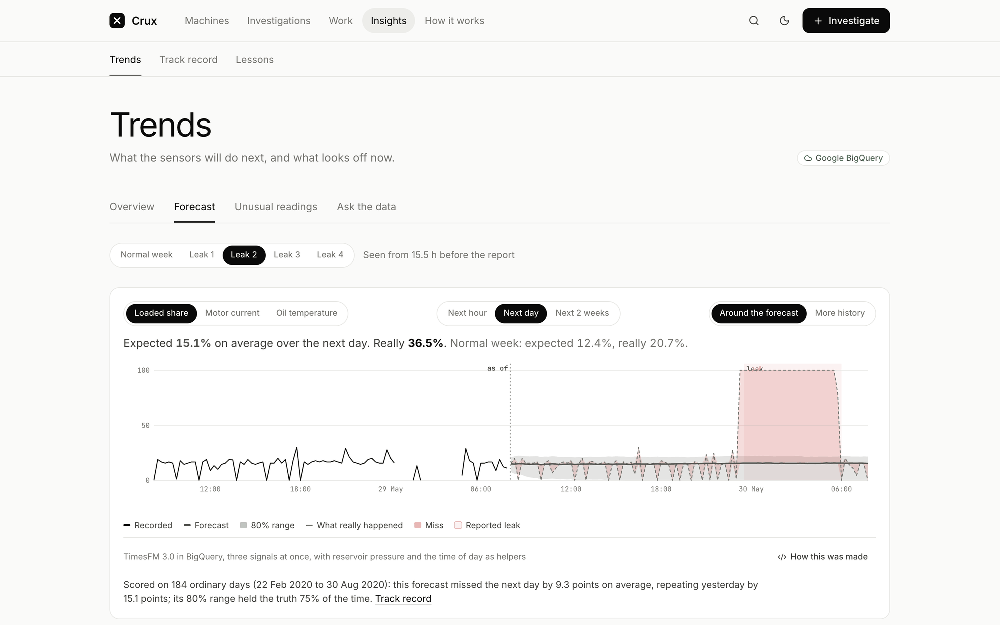<br><b>Forecast.</b> TimesFM 3.0's next day with its 80% range, beside what really happened.</td>
  </tr>
  <tr>
    <td>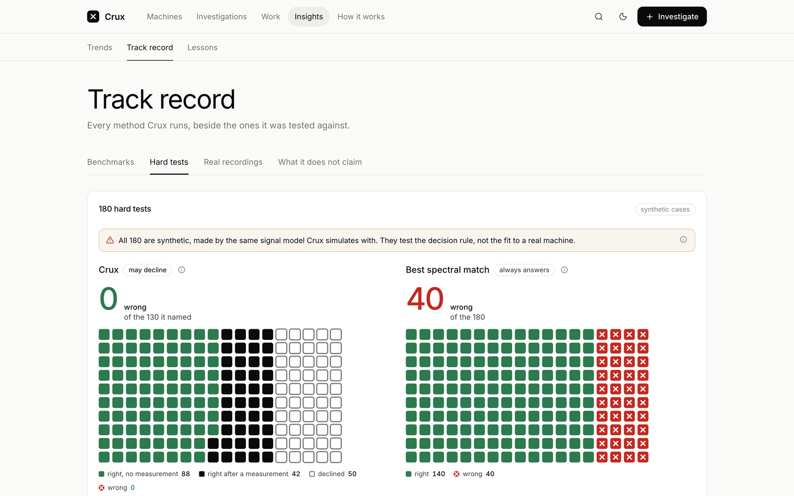<br><b>Track record.</b> Crux against the method that always answers, on 180 hard synthetic cases.</td>
    <td>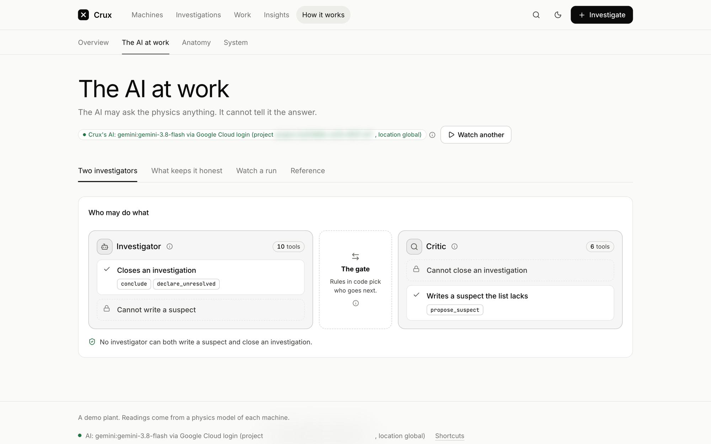<br><b>The AI at work.</b> Who may do what, the rules that keep it honest, and a run replayed call by call.</td>
  </tr>
  <tr>
    <td>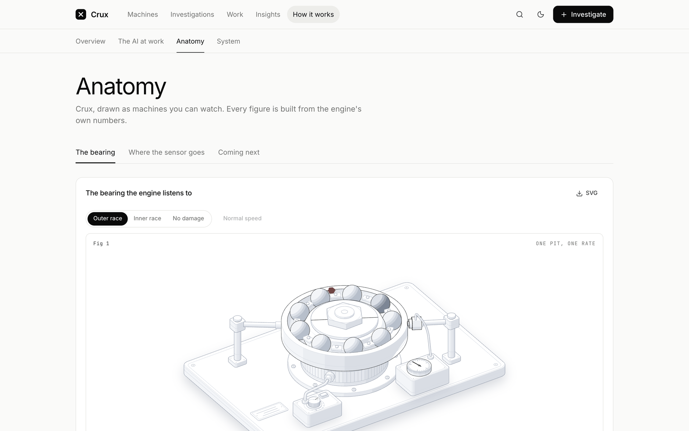<br><b>Anatomy.</b> The bearing and where the sensor goes, drawn from the engine's own numbers.</td>
    <td>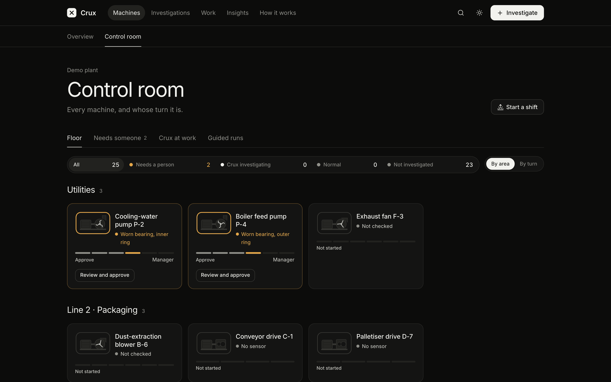<br><b>Light and dark.</b> The whole app in either theme, on desktop and phone.</td>
  </tr>
</table>

## Results

Every figure is labelled with what it was measured on. The full method and tables are in
[`docs/FORECAST.md`](docs/FORECAST.md) and [`docs/SERIES.md`](docs/SERIES.md), and in the app
under **Insights → Track record**.

**Diagnosis on 180 hard synthetic cases.** `uv run hypengine evaluate` runs three faults × three
strengths × four noise levels × five seeds. A requested measurement is answered by a new capture of
the same machine in the same state.

| Method | Right | Says it can't tell | Wrong |
|---|---:|---:|---:|
| **Crux** | 130 (88 at once, 42 after one measurement) | 50 | **0** |
| Naming the best spectral match | 140 | never | 40 |

The second row is the simplest method that always answers. Crux trades ten right answers for forty
fewer wrong ones. The cases come from the same signal model the engine simulates with, so this tests
the decision rule rather than the fit to a real machine.

**When to fix, on real run-to-failure bearings.**

| What | Data | Result |
|---|---|---|
| The watcher's alarm before failure | XJTU-SY test set, 15 bearings | fired before failure on **14 of 15** (the miss is a cage failure), 0.1 to 6.4 running hours ahead |
| Time left, as an 80% range | XJTU-SY, one bearing held out at a time | the range held the truth **80%** of the time; its early end was too late 9% of the time |
| The same model at another lab | NASA IMS, never seen in training | held the truth 65% of the time |

**Trends on a real compressor** (MetroPT-3, a metro train's air compressor, February to September 2020).
On the 184 ordinary days from 22 February to 30 August 2020, TimesFM 3.0's next-day forecast in
BigQuery missed **39% less** than repeating yesterday (9.3 against 15.1 points of loaded share).

## Architecture on Google Cloud

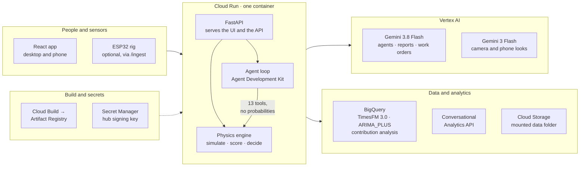

| Job | Google service |
|---|---|
| The app: UI and API on one origin | **Cloud Run**, built by **Cloud Build** into **Artifact Registry** |
| Investigator, critic, report, work orders, lessons | **Gemini 3.8 Flash on Vertex AI**, through the service's own Google Cloud login (no API key) |
| Camera stills and phone-video looks | **Gemini 3 Flash**, with code execution on so it can crop and zoom into a still |
| Agent loop | **Agent Development Kit** (`google-adk`) |
| Forecasts and unusual readings on sensor history | **TimesFM 3.0** in BigQuery (`AI.FORECAST`, `AI.DETECT_ANOMALIES`), scored again with `AI.EVALUATE` |
| What changed against a normal week | BigQuery ML **contribution analysis** |
| A signal split into trend, daily and weekly parts | BigQuery ML **ARIMA_PLUS** with `ML.EXPLAIN_FORECAST` |
| "Ask the data" in plain words | **Conversational Analytics API**, a Gemini data agent over the BigQuery tables |
| Lessons, time-left models, camera stills, phone scans | a **Cloud Storage** bucket mounted as the app's data folder |
| The learning hub's signing key | **Secret Manager** |

## Tech stack

| Layer | What |
|---|---|
| Engine | Python 3.11, NumPy, SciPy, Pydantic |
| API | FastAPI, Uvicorn; OpenAPI docs at `/docs` |
| Agents | Google Gen AI SDK (`google-genai`), Agent Development Kit (`google-adk`) |
| Forecasting | scikit-learn (time-left model), BigQuery ML and TimesFM (Trends) |
| Lens | PyAV and Pillow for video frames and audio |
| Web | React 19, TypeScript, Vite, React Router 7, Lucide icons, Inter and JetBrains Mono |
| CLI | Typer and Rich (`hypengine`) |
| Tooling | uv, Ruff, pytest (600+ tests), GitHub Actions |
| Hardware (optional) | ESP32 and MPU6050 accelerometer ([`docs/HARDWARE.md`](docs/HARDWARE.md)) |

## Quick start

**Prerequisites:** Python 3.11 and [uv](https://docs.astral.sh/uv/). Node 22 only to build the UI.

```bash
git clone https://github.com/Umang3172/crux.git && cd crux
uv sync --extra dev --extra llm        # the llm extra is the Gemini agents
```

**The whole loop in a terminal, with no keys and no hardware:**

```bash
uv run hypengine demo --fault outer_race               # watch one investigation
uv run hypengine investigate --fault rolling_element   # a fault the catalogue lacks: watch the critic
uv run hypengine evaluate --quick                      # how often is it wrong?
```

**The app** on <http://localhost:8080>:

```bash
make web-build      # builds web/ into the static bundle
make serve-app      # API and UI on one origin
```

For UI work with hot reload, run `make serve` (API) and `make web-dev` (Vite) side by side.

**In Docker:**

```bash
make docker-build && make docker-run      # http://localhost:8080
```

**The checks CI runs:**

```bash
uv run ruff check . && uv run ruff format --check . && uv run pytest
```

No keys are required. Without them the investigator runs its offline stand-in, every number is the
same, and `GET /health` and the page footer say which models are live.

## Configuration

Everything is optional; copy [`.env.example`](.env.example) to `.env` to turn things on.

| Variable | What it does |
|---|---|
| `GOOGLE_GENAI_USE_ENTERPRISE` | `true` to reach Gemini through Google Cloud's own login (Vertex AI). Locally, run `gcloud auth application-default login` first |
| `GOOGLE_CLOUD_PROJECT`, `GOOGLE_CLOUD_LOCATION` | The project and location for Vertex AI (`global` by default) |
| `GOOGLE_API_KEY` | Or reach Gemini with an API key instead |
| `GEMINI_MODEL` | The model every Gemini call site uses (default `gemini-3.8-flash`) |
| `GEMINI_VISION_MODEL`, `GEMINI_LENS_MODEL` | Models for the camera look and for Lens |
| `CRUX_REPORT_MODEL` | `off` keeps a model from writing the explanation beside a verdict |
| `RIG_INGEST_TOKEN` | The token the ESP32 posts with; empty turns `/ingest` off |
| `CRUX_DATA` | Where datasets and saved state live (default `data/`) |

Check every model call site with `uv run hypengine gemini-check`.

## Command line

| Command | What it does |
|---|---|
| `hypengine demo --fault <fault>` | One investigation on the synthetic rig, told step by step |
| `hypengine investigate --fault <fault> --severity 0.5 --noise 0.45` | The Gemini investigator, or its offline stand-in, on an induced fault (`rolling_element` and `unlisted_impact` are not in the catalogue) |
| `hypengine evaluate [--quick]` | The 180 hard synthetic cases, against the always-answer baseline |
| `hypengine benchmark` | The CWRU real-recording benchmark (fetch the data first, see [`docs/DATA.md`](docs/DATA.md)) |
| `hypengine gemini-check` | Which Gemini model each call site reaches, and whether it answers |
| `hypengine frequencies --rpm 1798` | The bearing's fault frequencies at a speed |
| `hypengine serve` | The API on port 8080 |

Faults: `healthy`, `imbalance`, `misalignment`, `looseness`, `outer_race`, `inner_race`, plus
`rolling_element` and `unlisted_impact`, which the catalogue lacks.

## HTTP API

The API serialises engine state and decides nothing. Interactive docs are at `/docs` on any running
instance, including the [live one](https://hypothesis-engine-errupcwbra-el.a.run.app/docs).

<details>
<summary><b>The main routes</b></summary>

| Route | What it does |
|---|---|
| `GET /health` | Status, and which model each AI job uses |
| `POST /investigations` | Open a case on a capture and run the virtual experiments |
| `GET /investigations/{id}` | The case: suspects, beliefs, ledger, requested measurement |
| `POST /investigations/{id}/evidence` | Hand in a requested measurement (the one door a reading comes in by) |
| `POST /investigations/{id}/evidence/phone` | Answer the requested check with a phone scan, with an uncertainty from the clip |
| `POST /investigations/{id}/notes` | A technician's note: kept and shown, never evidence; hazards raise a flag |
| `POST /investigations/{id}/repair` | The check after a repair: a new capture against the fault |
| `GET /investigations/{id}/report` | The report, each model sentence checked against its evidence |
| `POST /agent/stream` | Run the Gemini investigator and critic, streaming each tool call |
| `GET /agent/about` | The agents, their tools and their budgets |
| `POST /spectrum` | A measured capture drawn against one suspect's simulation |
| `GET /catalog`, `GET /tests` | The suspects and the measurement menu |
| `POST /ingest`, `GET /ingest/{machine}` | The live sensor route (needs `RIG_INGEST_TOKEN`) |
| `GET /tickets`, `POST /tickets/{id}/approve` | Work orders, and a named person's approval |
| `/maintenance/*` | Bearing lives replayed: health, alarms, time left |
| `/lens/*` | Phone scans: upload, analyse, keep as the machine's normal |
| `/series/*` | Trends: forecasts, unusual readings, changes, summaries, Ask the data |
| `/fleet/*` | Lessons, and signed updates between sites |

</details>

## Deploying to Cloud Run

One container serves both the UI and the API. [`cloudbuild.yaml`](cloudbuild.yaml) builds the UI,
resolves Python dependencies from `uv.lock`, pushes the image to Artifact Registry and deploys it to
Cloud Run with Gemini through the service account's own login, a Cloud Storage bucket mounted as the
data folder, and the hub key from Secret Manager.

```bash
make deploy   # or: gcloud builds submit --config cloudbuild.yaml --service-account <deployer>
```

One-time project setup (APIs, the Artifact Registry repository, a deploy identity with only the roles
it needs, the Vertex AI role, the data bucket and the secret) is step by step in
[`docs/DEPLOY.md`](docs/DEPLOY.md). [`.github/workflows/deploy.yml`](.github/workflows/deploy.yml)
deploys every push to `main` through workload identity federation, once the project's secrets are set
in the repository.

## Project layout

```text
src/hypothesis_engine/
  physics/          fault frequencies, fault signatures, the synthesiser, likelihood by simulation, the machine's own normal
  signals/          waveform to named observations: order tracking, spectrum, envelope
  investigation/    the loop, the one writer of beliefs, the measurement menu, the ledger, recorded runs as cases
  tools/            what a model may call on a case, and the one door a reading comes in by
  agents/           the investigator and critic loop, its offline stand-in, the report and its sentence check
  forecast/         the watcher, the health percent, time left as a range
  series/           Trends: BigQuery jobs, saved views, the benchmark, Ask the data
  ticket/           work orders, every sentence checked; the camera look
  fleet/            lessons from closed cases, and signed updates a person installs
  lens/             a phone video read as motion and sound, and as the answer to a case's check
  knowledge/        the machines' manuals and notes the critic can search
  data/             the synthetic rig and pump lives, loaders for recorded sets, the live sensor's buffer
  api/              the HTTP surface
web/                the app (React, TypeScript, Vite)
deploy/             the server the container runs
firmware/esp32_rig/ the sensor sketch that posts to /ingest
docs/               architecture, the physics, decisions, data, deploy
tests/              600+ tests, all runnable offline
```

Start with [`docs/ARCHITECTURE.md`](docs/ARCHITECTURE.md), then [`docs/DOMAIN.md`](docs/DOMAIN.md)
for the physics and the source of every constant, and [`docs/DECISIONS.md`](docs/DECISIONS.md)
(33 recorded decisions) for why each rule is there. [`docs/LENS.md`](docs/LENS.md),
[`docs/SERIES.md`](docs/SERIES.md), [`docs/FORECAST.md`](docs/FORECAST.md) and
[`docs/LEARNING.md`](docs/LEARNING.md) cover the rest.

## Design principles

1. **Physics decides, the model explains.** Beliefs move only through simulated likelihoods and
   measured evidence, in one function. A language model never edits one, and no tool would let it.
2. **"Can't tell" is an answer.** No verdict below 80%, and none while the capture holds something the
   leading suspect can't explain. A machine whose vibration has doubled over its own normal is never
   called healthy.
3. **Every claim cites evidence.** If it isn't in the ledger, it doesn't go in the conclusion or on
   the work order.
4. **No invented numbers.** Every constant that moves a belief is listed in `docs/DOMAIN.md` with where
   it comes from, and marked when it's a judgement call.
5. **Safety stays human.** Crux recommends; a named person approves. Nothing here touches machine control.
6. **It runs with no keys.** CI has no secrets; if a change breaks the offline path, it breaks the build.

## Datasets

No dataset ships in this repository or in the image; each is fetched by the person running it
([`docs/DATA.md`](docs/DATA.md), [`docs/FORECAST.md`](docs/FORECAST.md)).

| Dataset | Used for | Source |
|---|---|---|
| CWRU Bearing Data Center | the real-recording diagnosis benchmark; the bearing geometry | [engineering.case.edu/bearingdatacenter](https://engineering.case.edu/bearingdatacenter) |
| XJTU-SY bearings (15, run to failure) | the watcher and the time-left model | Wang et al., *IEEE Trans. Reliability* 69(1), 2020 |
| NASA IMS bearings | the time-left model at a lab it never saw | NASA prognostics data repository |
| MetroPT-3 (UCI 791) | Trends: a metro train's air compressor | [archive.ics.uci.edu/dataset/791](https://archive.ics.uci.edu/dataset/791) |

## Contributing

Issues and pull requests are welcome. Read [`CONTRIBUTING.md`](CONTRIBUTING.md) and
[`AGENTS.md`](AGENTS.md) first: they set the rules that keep the physics honest. In short:

- `uv` for everything, and `ruff` to lint and format.
- A new fault, test or feature lands with a test that would fail without it.
- A new constant goes in `physics/signatures.py` or `investigation/catalog.py`, with a row in
  `docs/DOMAIN.md` saying where it comes from.
- Conventional commits: `feat:`, `fix:`, `docs:`, `test:`, `chore:`.

## Team

Built by **Team MechNova** for the Google Cloud AI Builder Cup 2026 (Theme 3: Manufacturing):
**Umang Singh**, **Rajkamal Rajarshi** and **Puneet Shetty**. Profiles are on the
[documentation site](https://crux-docs-errupcwbra-el.a.run.app).

## Licence

[MIT](LICENSE) © 2026 MechNova
